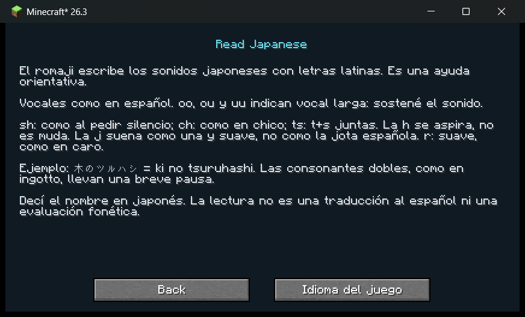

# SpeakCraft Survival

**Pronunciá el nombre de cada objeto nuevo para poder conservarlo.** Un mod de supervivencia con reconocimiento de voz offline, pensado primero para un jugador en Windows.

[Descargar 0.2.0](https://github.com/TomiDuarte/speakcraft-survival/releases/tag/v0.2.0) · [Instalación](INSTRUCCIONES_INSTALACION.md) · [Leer japonés](docs/JAPONES.md) · [Reportar un problema](https://github.com/TomiDuarte/speakcraft-survival/issues)

## Descargar e instalar

En **[Releases](https://github.com/TomiDuarte/speakcraft-survival/releases)** descargá:

- **`SpeakCraftSurvival-0.2.0-windows.zip`**: mod, instalador de modelos y documentación. Recomendado para empezar.
- **`speakcraft-survival-0.2.0.jar`**: únicamente el mod, si ya tenés todo preparado.
- `SHA256SUMS.txt`: huellas de los archivos publicados.

**Code → Download ZIP** descarga el código fuente; no es el paquete listo para jugar. Los modelos de voz se descargan por separado y no están dentro del JAR.

| Componente | Compatibilidad |
|---|---|
| Minecraft | **Java Edition 26.3**, exactamente |
| Loader | **Fabric**; probado con 0.19.5, uso reportado con 0.20.1 |
| Fabric API | **0.165.0+26.3** |
| Java | **25 x64** |
| Sistema inicial | **Windows 10/11 x64**; pruebas locales en Windows x64 |
| Juego | Supervivencia individual con servidor integrado |

No es para Bedrock, Forge/NeoForge, snapshots 26.4 ni otras versiones de Minecraft. macOS, Linux y servidores públicos no están verificados. Las versiones futuras requieren pruebas y posiblemente cambios: renombrar el JAR no agrega compatibilidad.

1. Abrí Minecraft Java 26.3 una vez y cerrá el juego y el launcher.
2. Instalá [Fabric Loader](https://fabricmc.net/use/installer/) para **26.3** y seleccioná su perfil en el launcher.
3. En `mods` de esa instancia colocá SpeakCraft y [Fabric API 0.165.0+26.3](https://maven.fabricmc.net/net/fabricmc/fabric-api/fabric-api/0.165.0+26.3/fabric-api-0.165.0+26.3.jar). No dejes dos versiones de SpeakCraft juntas.
4. Extraé el paquete descargado. Desde su carpeta, instalá el modelo que quieras usar:

```powershell
# Japonés; cambiá ja por es o de para otro idioma.
powershell -ExecutionPolicy Bypass -File .\scripts\Install-VoskModels.ps1 `
  -GameDirectory "$env:APPDATA\.minecraft" -Languages ja
```

5. Abrí el perfil Fabric, presioná **F8**, elegí idioma y micrófono, y usá **Probar voz / Test voice**. Guardá y entrá a supervivencia.

Si usás otra carpeta de juego, reemplazá `GameDirectory`. [Instrucciones detalladas](INSTRUCCIONES_INSTALACION.md).

## Cómo se juega

Cuando recogés o fabricás un tipo de objeto todavía bloqueado, el servidor retiene su stack. Aparecen nombre oficial, ícono y un desafío de voz de **15 segundos**, configurables. El tiempo comienza cuando el micrófono está listo.

- **UNLOCKED!**: recibís lo retenido y ese Registry ID queda desbloqueado para tu jugador en ese mundo.
- **DELETED!**: venció el tiempo; se elimina únicamente la obtención retenida. Podés volver a intentarlo al conseguir ese tipo de objeto otra vez.
- Una respuesta incorrecta permite repetir durante la cuenta regresiva.
- Los tipos distintos forman una cola; las adquisiciones pendientes del mismo tipo se agrupan.
- Si falta el modelo o falla el audio, se suspende sin penalización. Los objetos quedan guardados; corregí el problema y pulsá **Guardar y reanudar**.

Se cubren suelo, inventario 2×2 y mesa 3×3, incluidos stacks, Shift + clic y Q. Los objetos retenidos no pueden usarse. Si el inventario está lleno al acertar, la entrega espera hasta que haya espacio. Creativo y espectador no generan desafíos.

## Idiomas y japonés

| Idioma | Código | Modelo oficial Vosk |
|---|---|---|
| Español | `es` | `vosk-model-small-es-0.42` |
| Alemán | `de` | `vosk-model-small-de-0.15` |
| Japonés | `ja` | `vosk-model-small-ja-0.22` |

Cada idioma necesita su modelo. Sin `-Languages`, el script instala los tres. El mod **nunca descarga modelos automáticamente**. Los nombres de los desafíos son independientes del idioma de los menús.

En japonés activá **Lectura / Reading hints**. La versión 0.2.0 agrega lecturas latinas para **2.777 claves del catálogo**, incluidos nombres y variantes; no representa 2.777 objetos distintos.

| Objeto | Japonés | Ayuda visible |
|---|---|---|
| Tronco de roble | オークの原木 | `ooku no genboku` |
| Mesa de trabajo | 作業台 | `sagyoudai` |
| Pico de madera | 木のツルハシ | `ki no tsuruhashi` |
| Lingote de hierro | 鉄インゴット | `tetsu ingotto` |

La configuración incluye **Cómo leer japonés / Read Japanese**, con opción **Español**. El romaji es orientativo, basado en diccionario y correcciones; no es una traducción ni garantiza pronunciación nativa. Hay nombres ambiguos y entradas sin lectura; no se adivinan kanjis desconocidos. El reconocimiento sigue comparando el nombre japonés. [Guía y criterios](docs/JAPONES.md).



Para agregar otro idioma o corregir lecturas: [CONTRIBUTING.md](CONTRIBUTING.md). Copiar una carpeta de modelo no agrega por sí solo un idioma nuevo al selector.

## Privacidad, límites y avisos

- El audio se procesa localmente con **Vosk**, sin APIs de pago ni envío de audio por este mod a Internet. El mod no guarda grabaciones. Captura durante un desafío o una prueba explícita.
- La transcripción pasa del cliente al servidor que valida el desafío; en un jugador es local. No se garantiza privacidad frente a servidores ajenos ni clientes modificados.
- La tolerancia compara texto reconocido. **No mide científicamente calidad fonética** ni sustituye enseñanza del idioma.
- **Prototipo experimental 0.x**: hacé copia de seguridad de tus mundos antes de actualizar. La mecánica elimina intencionalmente objetos retenidos al vencer el plazo.
- Cofres, hornos, intercambios y otras fuentes aún no están integrados. El intercambio numérico/mano secundaria de un resultado bloqueado se rechaza sin gastar ingredientes; usá clic, Shift o Q.
- Los nombres de otros mods sin traducción suspenden el desafío. Las lecturas japonesas pueden necesitar correcciones.
- No es un antitrampas: un cliente modificado puede falsificar transcripciones. El guardado vanilla no garantiza transacciones atómicas entre archivos ante un corte eléctrico.
- **No es un producto oficial de Minecraft. No está aprobado ni asociado con Mojang o Microsoft.** No incluye el juego ni otorga acceso a Minecraft.

Código propio bajo [MIT](LICENSE). Las traducciones y dependencias conservan sus derechos y licencias: [THIRD_PARTY_NOTICES.md](THIRD_PARTY_NOTICES.md).

## Desarrollo y verificación

Requiere JDK 25. Usa Gradle Wrapper 9.6.0 y `net.fabricmc.fabric-loom` 1.17.21, para Minecraft sin ofuscación.

```powershell
.\gradlew.bat build
.\gradlew.bat runClient
python -m unittest discover -s scripts/readings -p "test_*.py"
```

`build` ejecuta JUnit y GameTests; el JAR queda en `build/libs`. La simulación de voz solo existe en pruebas y no se incluye en el mod. El CI compila y prueba en Windows con Java 25. [Verificación](VERIFICACION.md) · [Historial](CHANGELOG.md).
